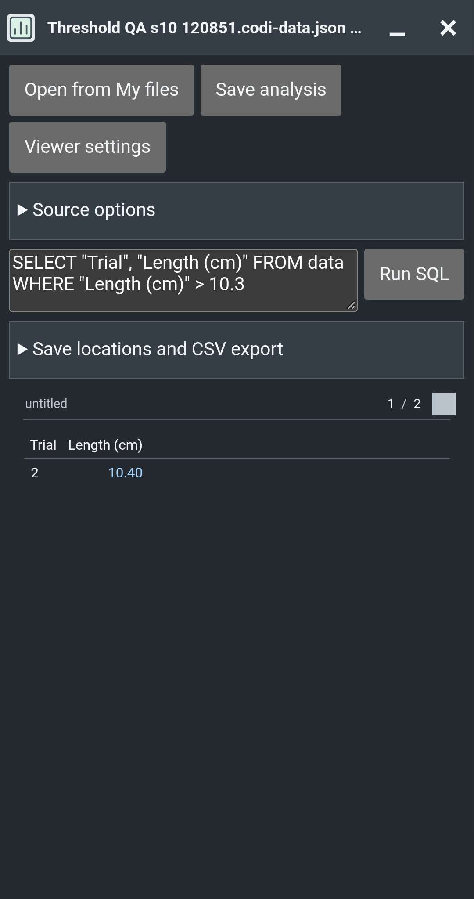

# Data Explorer on the Galaxy S10+

Runtime source `da85284` in viewer `8ba9fd0bb526` uses the pinned DuckDB-Wasm and Perspective packages. The [app README](../../README.md) covers file formats, build inputs, and SQL limits.

1. In **My files**, select the measurement CSV exported by Spreadsheet and choose **Open With → Data Explorer**.
2. Run `SELECT "Trial", "Length (cm)" FROM data WHERE "Length (cm)" > 10.3`. The grid shows trial **2** with a length of **10.40**.
3. Open **Save locations and CSV export**. Enter **Documents/Threshold result** for the CSV and **Documents/Threshold analysis** for the project. Save each. The names gain `.csv` and `.codi-data.json`.
4. In a fresh signed-in session, open the analysis from **My files**. Confirm that the query and one-row table return. Keep the source CSV available so the project can rebuild its result.

Chrome 158 on the physical Galaxy S10+ passed at 411 CSS pixels. Chromium at 820 and 1300 CSS pixels replayed the workflow. Viewer settings opened and closed. The phone canceled folder selection and retained its query. The export rejected a destination that resolved to the source CSV. The source digest matched throughout, and the saved project recorded that digest.

The phone workflow covers selecting data, filtering with SQL, saving a result, and reopening the analysis. Chart interaction, grouping, TSV precision options, and large inputs still need physical-device checks.

On box-webhost, `sudo python3 -I -B /var/backups/webos-data-explorer-phone-analysis-files-8ba9fd0bb526/deploy-viewer.py rollback` restores viewer `8c65e86b901e`.

